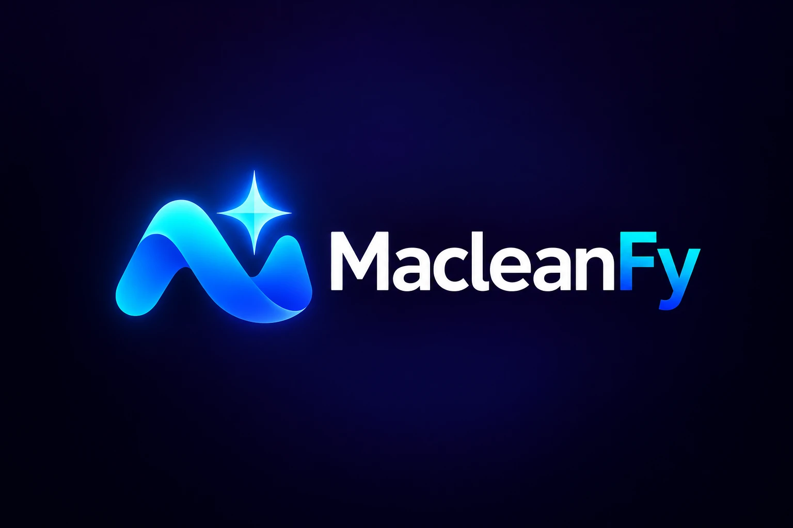
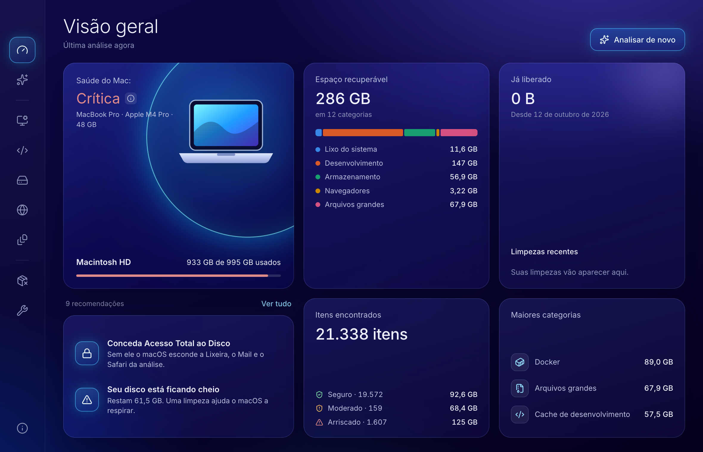

<p align="center">
  
</p>

<p align="center">
  An open source Mac cleaner with a graphical interface.<br>
  <a href="README.md">Português</a>
</p>



## Based on mac-cleaner-cli

MacleanFy is based on **[guhcostan/mac-cleaner-cli](https://github.com/guhcostan/mac-cleaner-cli)**,
a terminal tool released under the MIT license. The scanners and safety rules come from it;
MacleanFy adds the graphical interface. [NOTICE.md](NOTICE.md) lists what was copied, what
changed and what is new.

If you prefer the terminal, use the original project.

## What it does

**Overview.** Disk health, reclaimable space by group, what you have freed so far and
recommendations on what to clean first.

**Cleaning.** Sixteen categories in five groups. Each one shows its risk level, and you can
open a category to pick item by item.

| Group | Categories |
| --- | --- |
| System junk | app caches, logs, temporary files, language files, orphaned launch agents |
| Development | npm/Yarn/pnpm/pip/Gradle/Cargo/CocoaPods/Xcode caches, Homebrew, Docker, stale `node_modules` |
| Storage | Trash, old downloads, iOS backups, Mail attachments, duplicate files |
| Browsers | Chrome, Safari, Firefox and Arc caches |
| Large files | files over 500 MB in Downloads and Documents |

**Uninstaller.** Lists applications with the size of the app and of the files it left in
your Library, and moves everything to the Trash.

**Maintenance.** Flush the DNS cache and free purgeable space.

## Safety

A cleaner deletes files. These are the guards:

- **Scanning only reads.** Nothing is deleted before you review the list and confirm.
- **Only safe categories are pre-selected.** Moderate and risky ones wait for your choice.
  So does Docker, because cleaning it runs `docker system prune -af`.
- **Risky items ask for an extra confirmation**, and the dialog shows the warning for each.
- **You can do a dry run.** It walks through everything without deleting.
- **System paths are off limits.** `/System`, `/usr`, `/bin`, `/etc` and the like are
  refused on removal and never even listed.
- **Temporary files in use are left alone.** Only what has been idle for over a day is
  offered; sockets and folders with recent activity never are.
- **The interface does not dictate paths.** The process that deletes only accepts what the
  last scan returned. The interface runs isolated, with no access to Node or the disk.
- **Uninstalling is reversible.** Apps go to the Trash.

Cleaning a category **is permanent**: files do not go through the Trash.

## Running it

Requirements: macOS 12 or later, Node 22 and [pnpm](https://pnpm.io).

```bash
git clone https://github.com/Meigston/MacleanFy.git
cd MacleanFy
pnpm install
pnpm dev
```

### Building the installer

```bash
pnpm dist
```

It creates two installers in `dist/`:

| File | For |
| --- | --- |
| `MacleanFy-<version>-arm64.dmg` | Apple Silicon Macs (M1 or later) |
| `MacleanFy-<version>-x64.dmg` | Intel Macs |

Open the `.dmg` and drag MacleanFy to the Applications folder.

Without a certificate the build is ad-hoc signed: it opens on the Mac that compiled it, but
macOS blocks it on any other Mac it is copied or downloaded to. There is no signed and
notarized installer to download yet.

### Signing and notarizing

To distribute it, the installer needs a *Developer ID Application* certificate and Apple
notarization. With the certificate in your Keychain:

```bash
export CSC_NAME="Your Name (TEAMID)"
export APPLE_API_KEY=/path/to/AuthKey_XXXXXXXXXX.p8
export APPLE_API_KEY_ID=XXXXXXXXXX
export APPLE_API_ISSUER=00000000-0000-0000-0000-000000000000
pnpm dist
```

Instead of the API key you can use a `notarytool` profile (`APPLE_KEYCHAIN_PROFILE`) or
`APPLE_ID`, `APPLE_APP_SPECIFIC_PASSWORD` and `APPLE_TEAM_ID`. None of these credentials
belong in the repository.

### Full Disk Access

Without it macOS hides the Trash, Mail and Safari, and the scan shows those categories as
empty. Grant it in **System Settings → Privacy & Security → Full Disk Access** — the app has
a shortcut under *About & settings*. In development the permission applies to the terminal
you ran `pnpm dev` from.

## Project layout

```
src/
  core/       engine: scanners, safety rules and uninstall (derived from mac-cleaner-cli)
  main/       Electron main process: scanning, cleaning, history and system
  preload/    the only bridge between the interface and the main process
  shared/     the contract of that bridge
  renderer/   the React interface
```

The interface ships in Portuguese (Brazil) and English, following the system language.

## Support the project

MacleanFy is free and open source. If it helped you, a contribution keeps the project going.
In the app, the same options are on the **Support** screen.

### 🌎 Stripe — outside Brazil

**[Contribute through Stripe](https://donate.stripe.com/cNidR81zYdGPfZngEVgUM00)**: you choose the amount and pay in US dollars by card,
Apple Pay or Google Pay.

### 🇧🇷 Pix — Brazil only

To Meigston da Silva Ramos. Open your bank app, choose to pay with Pix and point the camera at
one of the QR codes, or paste a code under *Pix copia e cola*.

| R$ 10.00 | Another amount |
| :---: | :---: |
|  |  |

Pix code for R$ 10.00:

```
00020126580014BR.GOV.BCB.PIX01363da966f1-bd8d-488e-89a9-faadb0e5b63a520400005303986540510.005802BR5923Meigston da Silva Ramos6009SAO PAULO62140510wgZQvZ2KYU6304BF83
```

Pix code for another amount, which you choose in your bank app:

```
00020126580014BR.GOV.BCB.PIX01363da966f1-bd8d-488e-89a9-faadb0e5b63a5204000053039865802BR5923Meigston da Silva Ramos6009SAO PAULO62070503***63042E26
```

## License

[MIT](LICENSE). Parts of the code come from mac-cleaner-cli, also MIT — see
[NOTICE.md](NOTICE.md).

MacleanFy deletes files. It is provided without warranty: review the list before confirming
and keep a backup of what matters.
