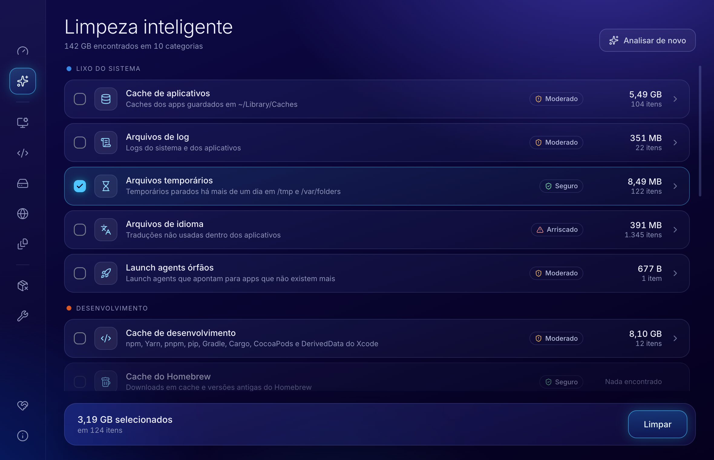

<p align="center">
  
</p>

<p align="center">
  Limpeza do Mac com interface gráfica, de código aberto.<br>
  <a href="README.en.md">English</a>
</p>


## Baseado no mac-cleaner-cli

O MacleanFy é baseado no **[guhcostan/mac-cleaner-cli](https://github.com/guhcostan/mac-cleaner-cli)**,
uma ferramenta de terminal publicada sob a licença MIT. Os scanners e as regras de segurança
vêm de lá; o MacleanFy acrescenta a interface gráfica. O detalhe do que foi copiado, do que
mudou e do que é novo está em [NOTICE.md](NOTICE.md).

Se você prefere o terminal, use o projeto original.

## Instalar

Baixe o instalador da [versão mais recente](https://github.com/Meigston/MacleanFy/releases/latest):

| Seu Mac | Instalador |
| --- | --- |
| Apple Silicon (M1 ou mais novo) | **[MacleanFy-arm64.dmg](https://github.com/Meigston/MacleanFy/releases/latest/download/MacleanFy-arm64.dmg)** |
| Intel | **[MacleanFy-x64.dmg](https://github.com/Meigston/MacleanFy/releases/latest/download/MacleanFy-x64.dmg)** |

Na dúvida, abra o menu Apple → **Sobre Este Mac**: se houver uma linha "Chip", é Apple
Silicon; se houver "Processador", é Intel. Requer macOS 12 ou mais novo.

1. Abra o `.dmg` e arraste o MacleanFy para a pasta Aplicativos.
2. Abra o MacleanFy. Na primeira vez o macOS bloqueia, porque o instalador ainda não é
   assinado nem notarizado pela Apple. Para liberar:
   - **macOS 15 ou mais novo:** feche o aviso, abra **Ajustes do Sistema → Privacidade e
     Segurança**, role até o fim e clique em **Abrir Mesmo Assim**.
   - **macOS 12 a 14:** clique no app com o botão direito, escolha **Abrir** e confirme.
   - Ou rode no Terminal: `xattr -dr com.apple.quarantine /Applications/MacleanFy.app`
3. Para a análise enxergar a Lixeira, o Mail e o Safari, conceda o
   [Acesso Total ao Disco](#acesso-total-ao-disco).

A página da versão traz o SHA-256 de cada instalador. Para conferir o que você baixou:

```bash
shasum -a 256 ~/Downloads/MacleanFy-arm64.dmg
```

## O que ele faz

**Visão geral.** Saúde do disco, espaço recuperável por grupo, o que já foi liberado e
recomendações do que limpar primeiro.

**Limpeza.** Dezesseis categorias em cinco grupos. Cada uma traz o nível de risco, e dá para
abrir a categoria e escolher item a item.

| Grupo | Categorias |
| --- | --- |
| Lixo do sistema | cache de aplicativos, logs, temporários, arquivos de idioma, launch agents órfãos |
| Desenvolvimento | caches de npm/Yarn/pnpm/pip/Gradle/Cargo/CocoaPods/Xcode, Homebrew, Docker, `node_modules` parados |
| Armazenamento | Lixeira, downloads antigos, backups do iOS, anexos do Mail, arquivos duplicados |
| Navegadores | cache do Chrome, Safari, Firefox e Arc |
| Arquivos grandes | arquivos acima de 500 MB em Downloads e Documentos |

**Desinstalador.** Lista os aplicativos com o tamanho do app e dos arquivos que ele deixou
na Biblioteca, e manda tudo para a Lixeira.

**Manutenção.** Limpar o cache de DNS e liberar espaço purgável.



## Segurança

Um limpador apaga arquivos. Estas são as travas:

- **Analisar só lê.** Nada é apagado antes de você conferir a lista e confirmar.
- **Só o que é seguro vem marcado.** Categorias moderadas e arriscadas esperam a sua escolha.
  O Docker também, porque a limpeza dele é um `docker system prune -af`.
- **Itens arriscados pedem uma confirmação a mais**, e o diálogo mostra o aviso de cada um.
- **Dá para simular.** A opção "Só simular" percorre tudo sem apagar nada.
- **Caminhos do sistema são intocáveis.** `/System`, `/usr`, `/bin`, `/etc` e afins são
  recusados na remoção e nem chegam a aparecer na lista.
- **Temporários em uso ficam de fora.** Só entra o que está parado há mais de um dia;
  soquetes e pastas com atividade recente nunca entram.
- **A interface não dita caminhos.** O processo que apaga só aceita o que a última análise
  devolveu. A interface roda isolada, sem acesso ao Node nem ao disco.
- **Desinstalar é reversível.** Os apps vão para a Lixeira.

A limpeza das categorias **é permanente**: os arquivos não passam pela Lixeira.

## Rodar a partir do código

Requisitos: macOS 12 ou mais novo, Node 22 e [pnpm](https://pnpm.io).

```bash
git clone https://github.com/Meigston/MacleanFy.git
cd MacleanFy
pnpm install
pnpm dev
```

### Gerar o instalador

```bash
pnpm dist
```

Saem dois instaladores em `dist/`:

| Arquivo | Para |
| --- | --- |
| `MacleanFy-arm64.dmg` | Macs com Apple Silicon (M1 ou mais novo) |
| `MacleanFy-x64.dmg` | Macs com Intel |

Sem certificado o build sai com assinatura ad-hoc: abre direto no Mac em que foi compilado,
e em qualquer outro o macOS pede a liberação descrita em [Instalar](#instalar). Os
instaladores publicados hoje são desse tipo.

### Assinar e notarizar

Para distribuir, o instalador precisa de um certificado *Developer ID Application* e da
notarização da Apple. Com o certificado no Keychain:

```bash
export CSC_NAME="Seu Nome (TEAMID)"
export APPLE_API_KEY=/caminho/AuthKey_XXXXXXXXXX.p8
export APPLE_API_KEY_ID=XXXXXXXXXX
export APPLE_API_ISSUER=00000000-0000-0000-0000-000000000000
pnpm dist
```

No lugar da chave de API servem um perfil do `notarytool` (`APPLE_KEYCHAIN_PROFILE`) ou
`APPLE_ID`, `APPLE_APP_SPECIFIC_PASSWORD` e `APPLE_TEAM_ID`. Nenhuma dessas credenciais
entra no repositório.

### Acesso Total ao Disco

Sem essa permissão o macOS esconde a Lixeira, o Mail e o Safari, e a análise mostra essas
categorias vazias. Conceda em **Ajustes do Sistema → Privacidade e Segurança → Acesso Total
ao Disco** — o app tem um atalho em *Sobre e ajustes*. Em desenvolvimento a permissão vale
para o terminal de onde você rodou `pnpm dev`.

## Como o projeto está organizado

```
src/
  core/       motor: scanners, regras de segurança e desinstalação (derivado do mac-cleaner-cli)
  main/       processo principal do Electron: análise, limpeza, histórico e sistema
  preload/    a única ponte entre a interface e o processo principal
  shared/     o contrato dessa ponte
  renderer/   a interface em React
```

| Comando | O que faz |
| --- | --- |
| `pnpm dev` | abre o app com recarga automática |
| `pnpm test` | roda os testes |
| `pnpm typecheck` | checa os tipos |
| `pnpm lint` | roda o ESLint |
| `pnpm build` | compila para `out/` |
| `pnpm dist` | compila e empacota o `.dmg` |
| `pnpm icon` | refaz o ícone do app a partir do símbolo |

## Design

A interface segue o Nocturne, o sistema de design do
[Airdroidfy](https://airdroidfy.com): superfícies escuras, elevação feita de borda de 1px e
uma regra que atravessa tudo — o acento é linha e brilho, nunca um bloco de cor. O acento é
o azul → ciano da logo. Os tokens ficam em
[`src/renderer/src/theme/tokens.css`](src/renderer/src/theme/tokens.css).

As cores dos gráficos não são as da marca de propósito: foram validadas para o fundo escuro
e para daltonismo.

## Contribuindo

Problemas, ideias de categoria e pull requests são bem-vindos. Veja
[CONTRIBUTING.md](CONTRIBUTING.md).

## Apoie o projeto

O MacleanFy é gratuito e de código aberto. Se ele te ajudou, uma contribuição mantém o projeto
andando. No app, as mesmas opções ficam na tela **Apoiar**.

### 🇧🇷 Pix — apenas Brasil

Para Meigston da Silva Ramos. Abra o app do seu banco, escolha pagar com Pix e aponte a câmera
para um dos QR codes, ou use o Pix copia e cola.

| R$ 10,00 | Outro valor |
| :---: | :---: |
|  |  |

Pix copia e cola de R$ 10,00:

```
00020126580014BR.GOV.BCB.PIX01363da966f1-bd8d-488e-89a9-faadb0e5b63a520400005303986540510.005802BR5923Meigston da Silva Ramos6009SAO PAULO62140510wgZQvZ2KYU6304BF83
```

Pix copia e cola de outro valor, que você escolhe no app do banco:

```
00020126580014BR.GOV.BCB.PIX01363da966f1-bd8d-488e-89a9-faadb0e5b63a5204000053039865802BR5923Meigston da Silva Ramos6009SAO PAULO62070503***63042E26
```

### 🌎 Stripe — outros países

**[Contribuir pelo Stripe](https://donate.stripe.com/cNidR81zYdGPfZngEVgUM00)**: você escolhe o valor e paga em dólar com cartão,
Apple Pay ou Google Pay.

## Licença

[MIT](LICENSE). Partes do código vêm do mac-cleaner-cli, também sob MIT — veja
[NOTICE.md](NOTICE.md).

O MacleanFy apaga arquivos. É distribuído sem garantia: confira a lista antes de confirmar e
mantenha um backup do que importa.
